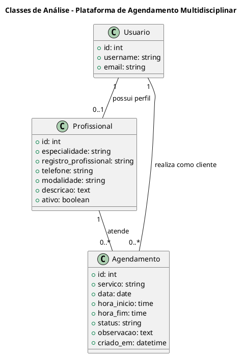

## Introdução

Este documento apresenta duas classes de análise desenvolvidas para a Plataforma Web de Agendamento Multidisciplinar para Saúde, Treinamento e Bem-Estar.

As classes foram identificadas a partir da pesquisa do tema, dos requisitos e do fluxo principal da aplicação. As classes selecionadas foram:

- Profissional
- Agendamento

## Metodologia

As classes foram selecionadas considerando as principais entidades necessárias para representar o domínio do sistema.

A classe Profissional representa os diferentes profissionais que poderão utilizar a plataforma. A classe Agendamento representa a relação entre um cliente, um profissional, um serviço e determinado horário.

## Classe Profissional

Tipo: entidade. Representa qualquer profissional que ofereça serviços através da plataforma. Entre eles estão Personal Trainer, Nutricionista, Fisioterapeuta, Professor de Pilates, Preparador Físico e outros. Todos são representados pela mesma classe e diferenciados pelo atributo `especialidade`; Personal Trainer é apenas uma das especialidades.

### Atributos

| Atributo | Descrição |
|---|---|
| id | Identificador do profissional |
| usuario | Usuário relacionado (relação 1 para 1) |
| especialidade | Área de atuação (Personal Trainer, Nutricionista, Fisioterapeuta, Professor de Pilates, Preparador Físico ou Outro) |
| registro_profissional | Registro profissional quando aplicável |
| telefone | Contato do profissional |
| modalidade | Presencial, online ou híbrido |
| descricao | Informações profissionais |
| ativo | Indica se está ativo no sistema |

## Classe Agendamento

Tipo: entidade. Representa uma reserva de atendimento entre um cliente e um profissional.

### Atributos

| Atributo | Descrição |
|---|---|
| id | Identificador do agendamento |
| cliente | Cliente que receberá o atendimento |
| profissional | Profissional responsável |
| servico | Serviço agendado |
| data | Data do atendimento |
| hora_inicio | Horário de início |
| hora_fim | Horário de término |
| status | Situação: Agendado, Confirmado, Concluído ou Cancelado |
| observacao | Observações opcionais |
| criado_em | Data de criação |

### Regras validadas

- o horário final deve ser posterior ao inicial;
- um profissional não pode ter dois agendamentos ativos sobrepostos;
- um cliente não pode ter dois agendamentos ativos sobrepostos;
- agendamentos cancelados não bloqueiam novos horários.

## Diagrama

Fonte: [classes_analise.puml](./classes_analise.puml).

## Relacionamentos

Um cliente pode possuir vários agendamentos. Um profissional pode possuir vários agendamentos. Cada agendamento deve estar relacionado a um cliente e a um profissional. Um usuário profissional possui um perfil `Profissional`.

## Implementação

As duas classes foram implementadas no app `agenda` do projeto Django (`src/agenda/models.py`) como Django Models, e registradas no Django Admin.

- `Profissional` possui `OneToOneField` com o usuário do sistema (`settings.AUTH_USER_MODEL`, `related_name="perfil_profissional"`).
- `Agendamento` possui `ForeignKey` para o cliente (`related_name="agendamentos_cliente"`) e para `Profissional` (`related_name="agendamentos"`). O serviço é, por ora, um campo de texto, pois ainda não existe a classe `Servico`.
- As validações são feitas no back-end, em `Agendamento.clean()`, chamado também em `save()`.
- As migrations do Django (`0002_profissional_agendamento`) transformam essas classes em tabelas no banco de dados.
- Os testes automatizados estão em `src/agenda/tests.py`.

## Conclusão

A utilização das classes Profissional e Agendamento permite representar o núcleo da plataforma sem limitar o sistema a uma única área profissional. Dessa forma, o mesmo sistema poderá atender personal trainers, nutricionistas, fisioterapeutas e outros profissionais.

## Versionamento

| Data | Versão | Descrição |
|---|---|---|
| 15/10/2026 | 1.0 | Criação das classes de análise e implementação inicial |
