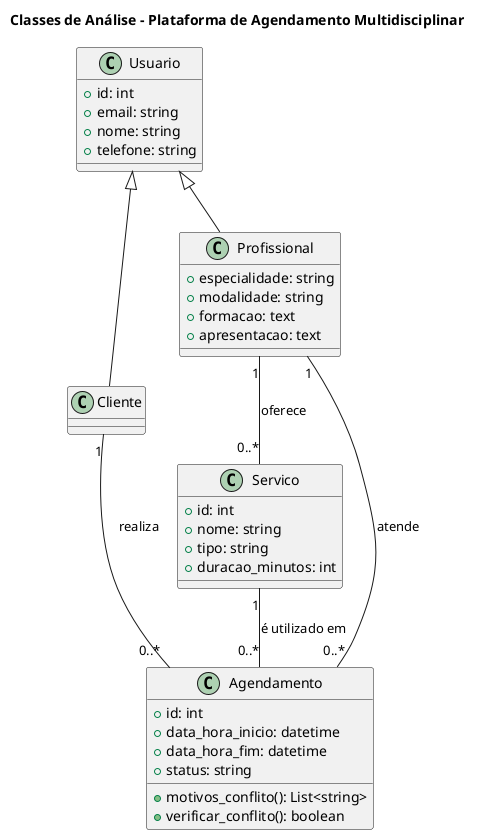

## Introdução

Este documento apresenta duas classes de análise desenvolvidas para a Plataforma Web de Agendamento Multidisciplinar para Saúde, Treinamento e Bem-Estar.

As classes foram identificadas a partir da pesquisa do tema, dos requisitos e do fluxo principal da aplicação. As classes selecionadas foram:

- Profissional
- Agendamento

## Metodologia

As classes foram selecionadas considerando as principais entidades necessárias para representar o domínio do sistema.

A classe Profissional representa os diferentes profissionais que poderão utilizar a plataforma. A classe Agendamento representa a relação entre um cliente, um profissional, um serviço e determinado horário.

## Classe Profissional

Tipo: entidade. Representa qualquer profissional que ofereça serviços através da plataforma. Entre eles estão Personal Trainer, Nutricionista, Fisioterapeuta, Professor de Pilates, Preparador Físico e outros. Todos são representados pela mesma classe e diferenciados pelo atributo `especialidade`; Personal Trainer é apenas uma das especialidades.

`Profissional` é uma especialização de `Usuario` (herança do Django): herda os dados de acesso e de contato e acrescenta os dados profissionais.

### Atributos

| Atributo | Descrição |
|---|---|
| id | Identificador (o mesmo do usuário) |
| email | E-mail usado no login (herdado de `Usuario`, único) |
| nome | Nome exibido no sistema (herdado de `Usuario`) |
| telefone | Contato (herdado de `Usuario`, opcional) |
| especialidade | Área de atuação, em texto livre (ex.: Fisioterapia, Nutrição, Pilates) |
| modalidade | Presencial, online ou híbrido |
| formacao | Formação profissional (opcional) |
| apresentacao | Texto de apresentação exibido no perfil (opcional) |

## Classe Agendamento

Tipo: entidade. Representa uma reserva de atendimento entre um cliente e um profissional, para um serviço, em um intervalo de data e hora.

### Atributos

| Atributo | Descrição |
|---|---|
| id | Identificador do agendamento |
| cliente | Cliente que receberá o atendimento |
| profissional | Profissional responsável |
| servico | Serviço agendado; sua duração define o horário de término |
| recepcionista | Recepcionista que registrou o atendimento, quando feito pela recepção (opcional) |
| sala | Sala reservada (opcional) |
| recursos | Equipamentos reservados (zero ou mais) |
| recorrencia | Série semanal à qual o atendimento pertence (opcional) |
| data_hora_inicio | Data e hora de início |
| data_hora_fim | Data e hora de término |
| status | Situação: Agendado, Confirmado, Cancelado ou Concluído |

### Regras validadas

- o horário final deve ser posterior ao inicial; se não for informado, é calculado pela duração do serviço (RN07);
- o horário precisa caber numa faixa de disponibilidade do profissional (RN05) e não pode cair num bloqueio (RN13);
- um profissional não pode ter dois agendamentos ativos sobrepostos (RN01);
- um cliente não pode ter dois agendamentos ativos sobrepostos (RN02);
- uma sala não pode ser reservada duas vezes no mesmo intervalo (RN03);
- um equipamento de uso exclusivo não pode ser reservado duas vezes no mesmo intervalo (RN04);
- agendamentos cancelados não bloqueiam novos horários, e agendamentos concluídos não são revalidados.

## Diagrama

Fonte: [classes_analise.puml](./classes_analise.puml).

## Relacionamentos

Um cliente pode possuir vários agendamentos. Um profissional pode possuir vários agendamentos e oferecer vários serviços. Cada agendamento está relacionado a um cliente, a um profissional e a um serviço. `Cliente` e `Profissional` são especializações de `Usuario`.

## Implementação

As duas classes foram implementadas no app `agendamento` do projeto Django (`agendamento/models.py`) como Django Models, e registradas no Django Admin.

- `Profissional` é uma especialização de `Usuario`, com especialidade, modalidade de atendimento, formação e apresentação.
- `Agendamento` possui `ForeignKey` para o cliente, o profissional, o serviço, a recepcionista, a sala e a recorrência, e `ManyToManyField` para os equipamentos (`Recurso`).
- O serviço deixou de ser um campo de texto e virou a classe `Servico`, com duração em minutos, que define o horário de término do atendimento.
- As validações ficam no back-end, em `Agendamento.clean()` e `Agendamento.motivos_conflito()`. As telas chamam essa validação pelo `full_clean()` dos formulários, e a API REST (`/api/agendamentos/`) chama o mesmo `clean()` antes de salvar. O conflito de equipamento exclusivo também é checado ao vincular os equipamentos (`agendamento/signals.py`).
- As migrations do Django transformam essas classes em tabelas no banco de dados.
- As duas classes também têm CRUD na API REST: `/api/profissionais/` e `/api/agendamentos/` (GET, POST, PUT, PATCH e DELETE).
- Os testes automatizados estão em `agendamento/tests.py`.

## Conclusão

A utilização das classes Profissional e Agendamento permite representar o núcleo da plataforma sem limitar o sistema a uma única área profissional. Dessa forma, o mesmo sistema poderá atender personal trainers, nutricionistas, fisioterapeutas e outros profissionais.

## Versionamento

| Data | Versão | Descrição |
|---|---|---|
| 15/10/2026 | 1.0 | Criação das classes de análise e implementação inicial |
| 12/11/2026 | 1.1 | Atributos e diagrama alinhados a `agendamento/models.py`; validações e API REST descritas como estão no código |
